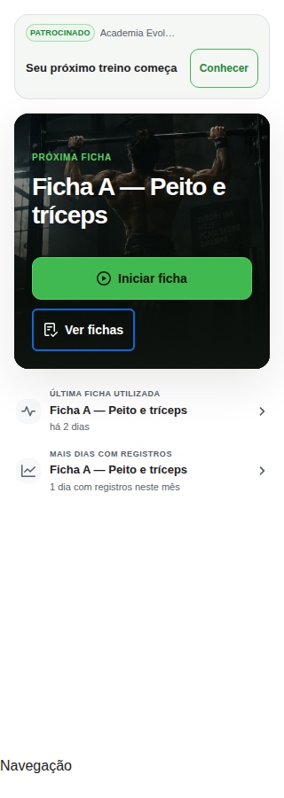
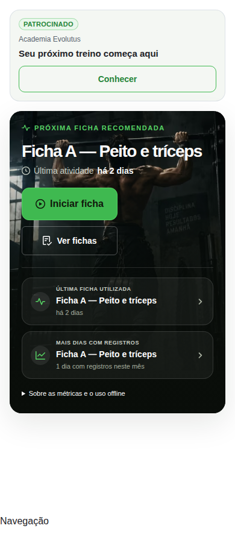
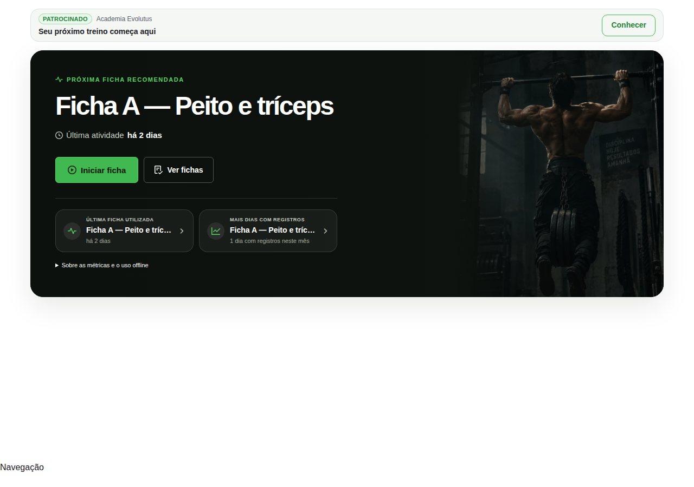
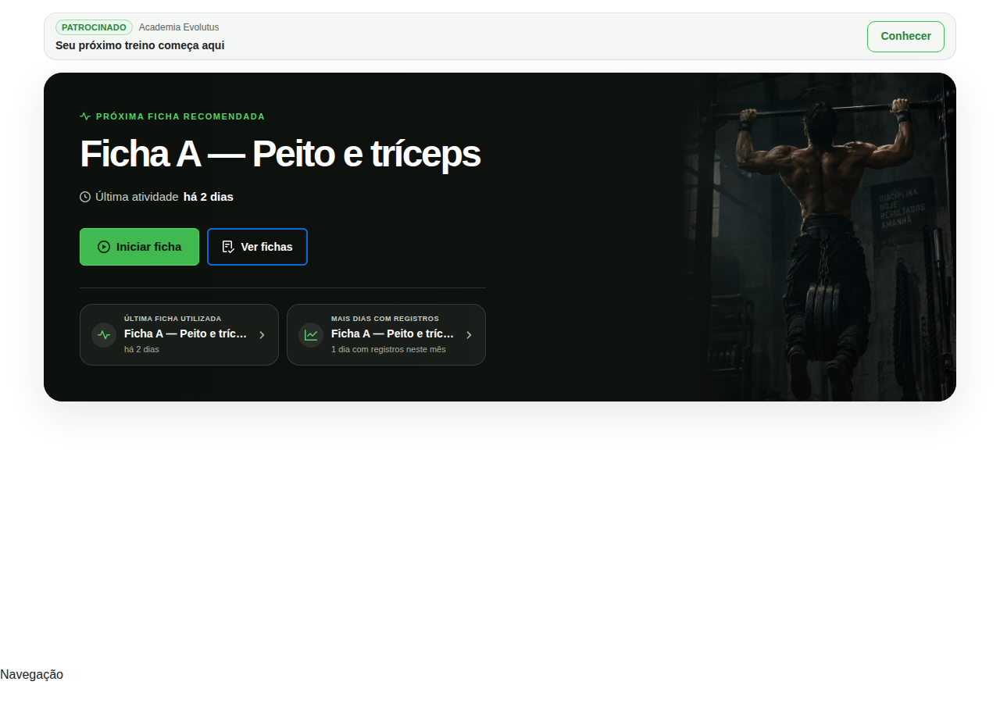

# Home V3 — hero mobile e hierarquia compacta

A Home mantém recomendação, métricas agregadas, cache e rotação diária existentes. Não há mudança de banco, migrations, autenticação, outbox, EvoCoins ou serviços de anúncios.

## Composição final

No mobile, a fotografia cobre todo o hero por posicionamento absoluto, `inset: 0`, largura/altura de 100% e `object-fit: cover`. A base usa `--fitness-photo-bg`; um gradiente escuro preserva a leitura e o enquadramento próximo ao topo. O conteúdo usa toda a largura, sobreposto à imagem. A altura mínima de 18rem permite que nomes longos ampliem o card naturalmente, sem altura fixa nem corte de texto.

O problema anterior vinha do `contain` herdado das fotos verticais e da altura fotográfica depender de um contêiner que incluía o `details`. Os indicadores agora têm um contêiner próprio, somente quando existem dados. Por solicitação do produto, a seção “Sobre as métricas e o uso offline” foi removida da interface, sem tooltip ou seção substituta. A fotografia é independente dos indicadores e não depende de conteúdo técnico expansível para preencher o card. O desktop mantém sua composição.

A identificação mobile é “PRÓXIMA FICHA”, com “· HOJE” somente quando a recomendação real é para hoje e ainda não tem atividade naquele dia. “Iniciar ficha” é a ação principal; “Ver fichas” reutiliza o mesmo Button secundário do desktop, com ícone, texto, borda, contraste e área de toque de 48px. Somente o padding e o espaçamento se adaptam ao mobile: os botões ficam lado a lado quando cabem e se organizam em linhas alinhadas à esquerda nas telas menores, sem reduzir a leitura ou criar uma aparência alternativa. Os indicadores usam tokens do tema fora da área fotográfica, sem cartões concorrendo com o destaque.

Somente o banner com placement `home_banner` recebe a composição mobile compacta: selo e anunciante, mensagem e CTA. Os hooks, timers, rotação, identificação publicitária, rolagem acessível da mensagem e métricas permanecem intactos. Comunidades e desktop mantêm o layout anterior. O cabeçalho de saudação da Home ganha tipografia/espaçamento compactos, sem alterar o shell de navegação.

## Antes e depois reproduzíveis

Capturas com dados sintéticos idênticos, mesmos assets reais e mesmo relógio. “Antes” carrega os componentes e CSS diretamente do commit de produção `4a50238b8d3c91f0627731cc69065dcd772406f0`; “depois” usa esta branch. São capturas do painel e anúncio, não de uma conta de produção.

| Tela | Antes | Depois |
| --- | --- | --- |
| 320 px |  |  |
| 390 px |  |  |
| 1280 px |  |  |

Altura do destaque principal no fixture (os indicadores passam para uma seção independente no mobile):

| Largura | Card anterior | Hero V3 |
| --- | --- | --- |
| 320 px | 529 px | 288 px |
| 390 px | 501 px | 288 px |

O anúncio mobile passa de 152px para 96px no fixture. Não se impõe uma redução percentual a nomes longos: a leitura completa tem prioridade.

Outras evidências: [mulher, 390px, dark](home-v3/female-390-dark.png), [nome longo, 320px, dark](home-v3/long-name-320-dark.png).

## Validação

`node scripts/home-v2-browser-smoke.mjs` verifica 120 combinações de fotografia (três perfis × quatro dias × cinco larguras × dois temas), com a ausência do aviso técnico explicitamente verificada. Compara o preenchimento do hero pela fotografia e pelo gradiente; verifica identidade da imagem, ausência de downloads extras, fallback, rotação e retorno após suspensão. Inclui nomes longos, ausência de fichas/histórico, CTA e selo do anúncio, largura da página e áreas de toque. Também confirma que o botão secundário mantém o ícone visível, o contorno sólido, o contraste do desktop e permanece dentro da linha de ações em todos os tamanhos.

A execução local final passou nas dez combinações de viewport/tema, 120 fotos, sem erros. Os 44 testes da Home e lint dos arquivos JS alterados passaram. As verificações pesadas completas (npm test, lint, build, segurança, pgTAP e funções) são executadas pelo CI oficial do PR. A simulação de CPU 4× lenta é obrigatória no runner isolado de CI; localmente não se introduz essa carga artificial para manter a prévia do Codespace responsiva.

Para reproduzir as capturas anteriores: `HOME_VISUAL_BASELINE=4a50238b8d3c91f0627731cc69065dcd772406f0 node scripts/home-v2-browser-smoke.mjs`. As capturas geradas completas ficam em `.finance-local/home-v3-before` e `.finance-local/home-v3-after`; somente as evidências selecionadas entram em docs. Elas não fazem parte do bundle do frontend.

## Limites e entrega

Os rótulos continuam descrevendo atividade e dias com registros; não representam conclusão de sessões. Novos registros criados somente offline ainda não recebem associação automática à ficha e não compõem esses indicadores. A limitação é preservada aqui como documentação técnica, sem o bloco informativo que foi removido da interface.

O excesso preexistente do budget global de bundle continua sendo um débito separado; nenhum limite foi aumentado. Nenhuma dependência, imagem de runtime, consulta, polling ou animação foi adicionada. O CI final e seu resultado ficam registrados no PR. Esta entrega não faz merge nem publica frontend ou banco de produção.
