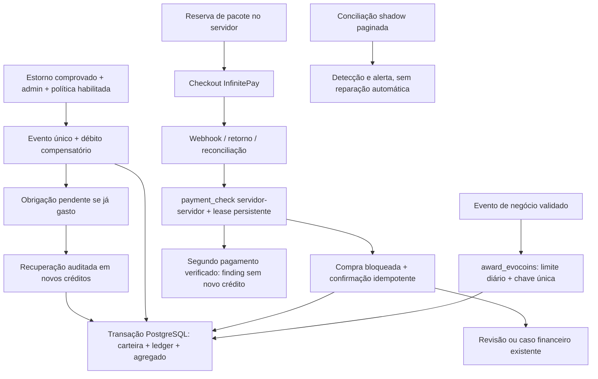

> **Finalização posterior:** [estado atual de segurança e publicação](finance-release-verification/LIBERACAO_SEGURANCA.md). Backup de banco restaurado; custódia externa, hold Vercel e CI/proteções continuam pendentes.

> **Verificação remota posterior:** autenticação e diagnóstico concluídos. O estado atual está em [finance-release-verification/RELATORIO_FINAL.md](finance-release-verification/RELATORIO_FINAL.md). Publicação continua bloqueada por recuperação e controle de implantação. O conteúdo abaixo preserva a evidência da estabilização anterior.

> **Atualização de estabilização (2026-10-23):** os resultados atuais estão em [finance-integration/RELATORIO_FINAL.md](finance-integration/RELATORIO_FINAL.md) e na seção `stabilization` de `ECONOMIA_EVIDENCIAS.json`. Os resultados abaixo preservam a auditoria histórica, com falhas já superadas. Estado atual: validação local concluída; publicação BLOQUEADA pela confirmação remota/recuperação pendentes.

# Auditoria e correção da economia Evolutus

## Escopo e evidência inicial — etapa 0

Base: commit 7398d68, em 2026-10-23. Documento de execução: `docs/prompts/PROMPT_AUDITORIA_E_CORRECAO_FINANCEIRA_EVOLUTUS.md`, lido integralmente. Sem deploy, pagamentos reais ou migrations remotas autorizados. Consulta CLI ao projeto evolutus.com.br confirmou versões locais/remotas coincidentes até 20261111000001, incluindo 20261105000003/04. O journal comprova versões registradas, não ausência de drift nas definições. Datas futuras são identificadores, não datas reais de execução.

Linha de base: lint sem erros/16 avisos; aplicação no sandbox 235 arquivos passaram/1 falhou (`businessDate`, subprocessos); functions 21 arquivos passaram, 32,02s; build passou em 93s com aviso de chunks. Repetição fora do sandbox e banco descartável em preparação. Logs em `/tmp/evolutus-baseline-*` e `/tmp/evolutus-finance-baseline-unsandboxed.log`.

### Inventário por evento

| Evento/origem | Autorização e entrada atual | Efeito/tabelas | Chave e concorrência | Cobertura existente/risco |
|---|---|---|---|---|
| Atividade | sessão + has_app_access; register_qualified_activity | checkpoints; award_evocoins → daily, ledger, wallet | daily-activity:dia; lock checkpoint/dia/carteira | evocoins_participation; tempo entre RPCs não prova atividade |
| Treino | complete_workout_session, data e created_at servidor | award_evocoins; coin e lifetime | workout:dia; lock daily/carteira | participation; treino continua autodeclarado |
| Post/comentário | trigger com auth.uid=autor; fila e revalidação no cron | pending_awards → mesmo motor | post:ID / comment:postID; unique e daily | participation; mídia/workout precisam prova de recurso e repetição |
| Apoio/voto | cast_vote valida acesso, membro, alvo, autoria; settle_vote_rewards | débito coin; prêmio autor; daily/votes/ledger/wallet | vote:post:charge; reward:post:votante; alvo/daily/carteira | support tests e participation; cap 10 preservado |
| Comunidade/tier | create_community/upgrade_community (fluxo antigo create_community_with_cash removido) | débito coin/cash, tier/membro/request | community-creation:ID; community-upgrade:ID:tier; wallet e unique | community_creation; repetir após corrida deve retornar operação original |
| Compra | Edge autentica; reserva service_role; payment_check servidor | purchase → ledger cash → wallet | order e transaction NSU únicos; lock purchase/carteira | infinitepay_cash_purchases; sem crédito por redirect |
| Promoção | create_promotion com owner/acesso/membro/pacote servidor | débito cash, ledger, promotion, flags alvo | owner/request unique; lock alvo/carteira | community_promotion_security; alvo comunidade lido sem lock na versão atual |
| Cancelamento | dono ou superadmin, motivo; expire_stale job | status local, sem débito/reembolso | lock purchase; replay | pending_reconciliation; cancelamento local não invalida link provedor |
| Revisão de compra | superadmin, nota; admin_resolve_cash_purchase_review | crédito verificado retido ou reembolso externo SEM crédito prévio | lock purchase; resolved_at/replay | pending_reconciliation; NULL resolution e reconfirmação após refund exigem correção |
| Exclusão | queue/worker, portão financeiro, separação admin | vínculo ledger/purchases → caso; pseudonimização/retention | purchase → wallet → deletion job; caso único | account_deletion/financial_case tests; não apagar histórico |
| Estorno de crédito já entregue | ausente | falta compensação e obrigação pendente | inexistente | confirmado: não coberto por refund_externally |
| Conciliação | expiração pending (cron); admin reconcile reusa payment_check | status/mesmo crédito atômico | SKIP LOCKED, lote <=500 | pending_reconciliation; expiração não é conciliação externa completa |

### Invariantes e decisões

EvoCoins/EvoCash são unidades inteiras positivas; BRL é separado em centavos inteiros. Saldo disponível nunca negativo; ledger e benefício/status confirmam na mesma transação; débito só com saldo e autorização; evento único produz no máximo um efeito; lifetime é crédito bruto histórico e não diminui em gasto/estorno. A leitura comum continua pela PK da carteira, sem somar extrato.

Não serão editadas migrations históricas. Candidatas novas após 20261111000001: permissões/precisão; integridade checkout; reversões; elegibilidade; conciliação shadow. Mudanças de regras comerciais não comprovadas permanecem pendentes, sem endpoints presumidos. Rollout: revisão de dados e drift → banco incremental → functions → frontend; ensaio do zero e incremental em banco descartável antes de aprovação de produção.

### Achados iniciais (reprodução e resultados finais serão acrescentados)

| ID | Classificação inicial | Severidade | Evidência |
|---|---|---|---|
| F01 | confirmado | alta | webhook usa apenas Content-Length, demais endpoints req.json sem limite; corpo sem header contorna proteção |
| F02 | confirmado | alta | helpers numeric aceitam frações/negativos; carteira integer arredonda implicitamente e ledger numeric preserva fração |
| F03 | mitigado | crítica | confirmação direta revogada de anon/authenticated; payment_check + locks + NSU unique já existem |
| F04 | confirmado | alta | admin_resolve usa `p_resolution not in` sem NULL; NULL cai no ELSE; compra `cancelled/refunded_externally` pode ser reconfirmada |
| F05 | confirmado | alta | promoção de comunidade lê alvo sem FOR UPDATE; duas requisições distintas podem ativar dois benefícios/debitar duas vezes |
| F06 | confirmado | alta | checkpoints isolados habilitam prêmio por passagem de tempo; post_is_rewardable aceita foto/treino sem verificar fonte |
| F07 | confirmado | alta | sem modelo de compensação para compra já creditada/gasta |
| F08 | confirmado | média | reconciliação existente expira pendentes; não detecta saldo materializado divergente; não deve ser duplicada |
| F09 | mitigado | alta | snapshots offline só exibição; autorização de gasto permanece no PostgreSQL |
| F10 | dependente de provedor | alta | ajuda oficial atual documenta options/single_payment/valid_until e API Key para opções avançadas; contrato legado não documenta consulta de estorno autenticada |

Fontes oficiais consultadas: https://www.infinitepay.io/checkout-documentacao e https://ajuda.infinitepay.io/pt-BR/articles/10766888-como-usar-o-checkout-integrado-da-infinitepay . A ajuda descreve eventos refunded, mas não publica contrato verificável de autenticação/payload/consulta de reembolso parcial/chargeback. Nenhum evento de estorno recebido por webhook será aceito como prova por si só.

## Implementação por etapa

| Etapa | Correção / proteção preservada | Arquivos principais | Evidência executada | Estado |
|---|---|---|---|---|
| 0 | inventário, estados e baseline; 148 migrations históricas do zero | este inventário; finance-prepare-local.sh | journal remoto previamente consultado; aplicação local 148/148; 62 arquivos SQL originais | concluída, drift remoto ainda não medido |
| 1 | limite real de bytes/tempo em quatro handlers; respostas do provedor limitadas; grants explícitos incluindo service API; paths fixos dos helpers | finance_permissions; limitedJson.js; handlers | corpos sem header/mentirosos, UTF8 inválido, fluxo parado, RPCs internos negados, A/B e RLS | implementação local |
| 2 | inteiros finitos positivos; constraints NOT VALID; ledger imutável; promoção serializada por usuário/alvo | finance_integrity | 100 replays da promoção; insuficiência; rollback; fração/NaN/Infinity/overflow; exclusão preservada | implementação local |
| 3 | finalização de reembolso externo; NULL rejeitado; reserva revalida acesso; lease persistente da verificação; identidade/moeda opcionais da resposta validadas; expiry congelada | finance_payment_finality; _shared/infinitepay.js; checkout core | 100 confirmações; mocks valor/NSUs/moeda/método/500/timeout; regras antigas preservadas | single_payment/valid_until dependem da API Key opcional e homologação |
| 4 | eventos de reversão comprovada, compensação, obrigação separada e recuperação; eventos administrativos consultáveis | finance_reversals; admin_cash_reversal_events; AdminCashPurchases | reembolso parcial/integral, repetição/conflito/excesso/sem saldo; corrida estorno+gasto | código pronto para staging, flag desativada até aprovação de política |
| 5 | heartbeat isolado não recompensa/não qualifica; fonte de treino/mídia verificada; texto repetido tem fingerprint único no ledger | finance_reward_evidence | fake resource, storage ausente, conteúdo repetido, evento legítimo; 100 awards com teto 10 | risco residual de ações autodeclaradas explicitado |
| 6 | conciliação shadow com cursor/checkpoint/findings; lote externo limitado e sequencial reutiliza confirmação; expiração antiga preservada | finance_reconciliation_shadow; admin-reconcile/batch.js | repetição não altera saldo/ledger; lote inválido negado; falha de item não aborta seguinte | sem cron novo ativado; identidade ausente exige painel do provedor |
| 7 | cache online antigo passa a snapshot informativo; saldo autenticado vazio até confirmação; retorno needs_review e rótulos de estorno; histórico admin | WalletContext; EvoCash; cashPurchaseFlow; AdminCashPurchases | testes de carteira offline/troca de conta/cache e rótulos | frontend local disponível no Vite existente |
| 8 | suítes SQL, handlers, regressão JS, carga limitada, medição idêntica antes/depois e ensaio incremental | testes finance_*; scripts/finance-audit-local.py | resultados finais abaixo | pendências de serviços externos registradas |
| 9 | ordem de rollout, diagnóstico read-only, constraints/índices, flags, runbook de incidentes e rollback operacional | ECONOMIA_RUNBOOK.md; finance_preflight_readonly.sql | nenhum comando de produção/deploy | preparado, publicação não autorizada |

### Estados financeiros após as correções

Reserva gera `pending` com lease; sucesso grava URL; timeout permanece pending/uncertain, sem nova criação cega; rejeição definitiva mantém `checkout_failed` e pode reutilizar a compra. `cancelled` significa cancelamento **local**; confirmação tardia comprovada continua no mesmo settlement. Pagamento em conta disabled resulta `needs_review`; caso separado resulta `held_in_case`; pagamento aceito gera `credited` + uma linha de crédito atômica. `refunded_externally` numa revisão sem crédito é final e não retorna à concessão. Estorno de compra já creditada conserva o estado/histórico de crédito original, grava evento de reversão e agregado `reversed_centavos`; a UI distingue parcial/integral. Obrigações ficam no evento, não em saldo disponível negativo. Nenhum estado de cancelamento no provedor é presumido.

### Achados encerrados e limitações

F01/F02/F04/F05/F06 têm controles e testes novos. F03/F09 eram proteções existentes, preservadas e ampliadas. F07 tem implementação administrativa condicionada à política de compensação; não há comprovação automática de chargeback por webhook. F08 recebe detecção paginada e replay seguro, sem fabricar saldo inicial. F10 foi comprovado na ajuda oficial para a integração com API Key; o contrato legado sem chave continua sem garantia de uso único do link no provedor. Cada uma dessas dependências está no runbook.

Não reproduzido: crédito por redirect falso, acesso autenticado direto aos helpers, dupla concessão por NSU/replay, saldo negativo em corrida ou gasto autorizado por snapshot. Testes demonstram estes cenários nas condições locais; não constituem segurança absoluta ou validação do gateway real.

Risco residual: treino e texto ainda são autodeclarados; recurso persistido e limite não provam humano. Fingerprint bloqueia repetição idêntica/normalizada, mas paráfrases, arquivos visualmente iguais com paths distintos e contas coordenadas exigem observação e revisão proporcional. Nenhuma punição definitiva por IP, lifetime reescrito, nível de reputação novo ou saldo paralelo foi introduzido.

### Carga e performance medidas

Carga sintética real no PostgreSQL 17.6, container limitado a 0,75 CPU/1 GiB, quatro conexões concorrentes no máximo, 100 tentativas por cenário. As latências incluem criação de processos Docker/psql; não representam latência HTTP do gateway em produção.

| Cenário | p50 ms | p95 ms | p99 ms | requisições/s | Resultado |
|---|---:|---:|---:|---:|---|
| confirmação do mesmo pagamento | 354,84 | 523,55 | 688,85 | 10,69 | um crédito |
| replay da promoção | 325,64 | 442,68 | 470,72 | 11,95 | um débito/benefício |
| gasto sem saldo | 363,85 | 505,68 | 529,66 | 10,65 | 100 rejeições esperadas, zero benefício |
| estorno concorrente com gasto | 368,69 | 507,24 | 553,78 | 10,73 | saldo zero e obrigação coerente; evento único |
| teto EvoCoins, fontes distintas | 341,65 | 496,12 | 542,91 | 11,33 | exatamente 10, carteira/lifetime/agregado/ledger coerentes |

Zero deadlocks/erros inesperados nesses cenários. São **100 tentativas com concorrência limitada a quatro**, não 100 conexões simultâneas; saturar o Codespace contrariaria a restrição de CPU do usuário. Carga de 50–100 conexões e p99 do webhook com rede/provedor pertencem à homologação dimensionada.

Microbenchmark: cinco amostras de 2.000 chamadas (1.000 créditos/débitos), em transações revertidas, comparando definições históricas com candidatas na mesma massa. Mediana anterior 609,235 ms; nova 771,190 ms: +161,955 ms por 2.000 chamadas (+26,58%; aproximadamente +0,081 ms/chamada). O acréscimo vem da validação e consulta de recuperação de obrigação, com índice parcial para pendências. Carteira comum continua por PK; não há soma de histórico no frontend. Conciliação é assíncrona/paginada, porém o custo da soma por carteira ainda depende do histórico daquele usuário; medir volumes representativos antes de agendar lotes grandes.

### Regressão SQL completa: comparação limpa

Baseline do HEAD: 62 arquivos, 55 passaram. Candidata: 68 arquivos, 61 passaram, 2.582 asserções aprovadas nos arquivos que chegaram às assertivas. Os seis adicionais incluem o pré-check read-only. Nenhuma falha nova na comparação.

Os mesmos sete arquivos falham antes/depois: `aud_community_covers_gates`, `community_member_removal`, `exercise_visuals`, `exercise_visuals_v2` dependem de schemas/grants do serviço Storage real (a baseline sintética só cria tabelas mínimas); `aud_has_app_access_gates`, `notification_security`, `security_followup` capturam uma função preexistente `set_training_preferences(jsonb)` com search_path=public e uma allowlist antiga que não contempla quatro RPCs públicas comerciais/profissionais adicionadas depois dos testes. Não fechar esses endpoints públicos legítimos para fazer um teste antigo passar. Não atribuir estas falhas às candidatas nem declarar a suíte SQL inteira verde.

Os dez arquivos financeiros/de exclusão selecionados passaram na baseline e na candidata. Testes antigos foram atualizados apenas quando a nova invariante justificou: savepoint em vez de apagar ledger, evento validado antes de premiar atividade, conta ativa ao reservar e criação de carteira sem crédito zero. Nenhuma migration histórica foi editada.

Mudanças de autenticação/offline surgiram em paralelo no workspace durante o trabalho; foram preservadas. Os testes finais refletem o estado dos arquivos no momento da execução, sem atribuir essas mudanças à auditoria financeira.

### Verificações finais e ressalvas do workspace compartilhado

- Cinco suítes financeiras novas: **64 assertivas aprovadas** (17 integridade, 11 finalização, 18 reversões incluindo exclusão/caso, 10 evidência de atividade, 8 conciliação). Script existente EvoCoins: 30 sessões de fontes distintas e 12 replays, todas as sete verificações passaram; fixtures agora usam UUID novo, sem apagar ledger para repetir cenário.
- Contrato de schema financeiro **igual** entre aplicação limpa e incremental: funções, ACLs, colunas, defaults, constraints/validação, índices e RLS. Consulta reproduzível em `scripts/homolog/finance-schema-contract.sql`; resultado e digest no JSON de evidências.
- `npm run test:functions`: **203 passaram, zero falhas, três skips** (206 testes). Inclui quatro handlers HTTP compilados, métodos/auth/corpo e ausência de efeito financeiro; contratos reais do provedor continuam dependentes de homologação.
- `npm run lint`: **zero erros/16 avisos**, os mesmos avisos-base. `npm run build`: **passou**, Vite em 18,31s, aviso preexistente de chunks grandes. Scan de 123 arquivos JS gerados: nenhum JWT service_role ou referência a variáveis secretas backend encontradas.
- `npm test` sequencial fora do sandbox: **2.087 passaram/duas falharam**, 268,71s. As duas falhas estão em `src/services/logoutScope.test.js`, cujo contrato foi alterado pelo trabalho paralelo de autenticação (`othersRevoked` e serialização entre escopos). Esses arquivos de implementação não foram reescritos por esta auditoria. Não declarar a suíte completa aprovada.
- Uma rodada posterior da suíte SQL, durante as edições paralelas, encontrou também `auth.sessions` ausente nos novos cenários de `offline_workout_sync_test.sql` (não existiam no teste original do HEAD). A migration 20261113000001 desse outro trabalho não foi aplicada aqui. A primeira tentativa dessa rodada iniciou antes do socket do container estar pronto; a função nova de conflito não foi aplicada naquela tentativa. A inicialização foi aguardada, a aplicação corrigida e todos os testes financeiros finais acima foram repetidos com sucesso. Não confundir esse erro transitório do ensaio com falha da migration candidata.
- As seis migrations permanecem **candidatas não publicadas**. Como houve alterações paralelas em Auth/offline e uma migration adicional, a homologação do conjunto combinado exige a suíte dessa outra entrega no ambiente com Auth/Storage reais.

As evidências estruturadas estão em `ECONOMIA_EVIDENCIAS.json`, com hashes das seis candidatas e resultados medidos. Os logs brutos permanecem em `/tmp/finance-*` e `/tmp/evolutus-finance-sql*`. Bancos de teste parados; Vite 5173 preservado. Não foi usado banco real para fixtures, carga, reembolso ou teste de exclusão.

### Arquitetura resultante

## Estabilização do conjunto integrado após PR #65

Base `0cdde0e`. Preservadas as seis migrations financeiras e as integrações Auth/offline. A falha administrativa histórica foi reproduzida e sua correção já integrada confirmada (76 assertivas). O wrapper local das Edge foi corrigido e tornou-se reproduzível após reinício do Codespace. Nenhuma proteção administrativa foi removida.

Encontrado e corrigido shadowing do catálogo de fusos em `set_training_preferences`: migration forward-only `20261115000001`, com nove novas assertivas. Mocks administrativos e fixtures de sessão foram alinhados ao contrato atual; o teste de notificações passou a isolar seu próprio destinatário. Nenhuma migration histórica foi editada.

Resultados finais: 68 suítes SQL/3.028 assertivas; subconjunto financeiro 73 assertivas após carga; 2.092 testes de aplicação; 207 Edge Functions sem skips; 26 logout; oito cenários HTTP com serviços reais e provedor simulado; Chromium offline aprovado. Lint zero erros/16 avisos existentes e build aprovado. Instalação limpa com 161 migrations e atualização com 148+13 preservaram dados e produziram contratos iguais.

Carga de 500 tentativas, no máximo quatro conexões: invariantes preservadas, zero novos deadlocks e recursos amostrados no container limitado. Resultados/limites detalhados no relatório, sem extrapolar para produção. Flags de estorno e novos cron permanecem desativados.

Disco recuperado de 100% para 59% (13 GB livres), removendo armazenamento antigo inativo e caches descartáveis; ambiente atual e arquivos do projeto preservados. `/app` volta a ser servido no Vite 5173.

CLI Supabase sem sessão: o pré-check remoto atual NÃO foi executado. Script read-only revisado e validado localmente; journal/schema/dados reais e backup/recuperação precisam de confirmação antes de autorizar publicação. Nenhum push, deploy ou pagamento real nesta execução.
