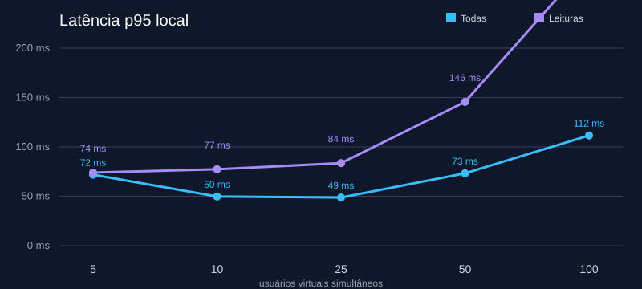
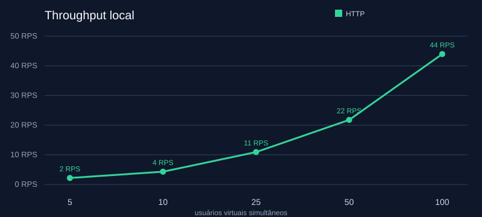
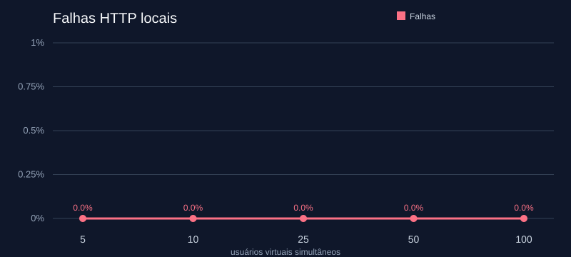

# Evolutus — auditoria prática de capacidade (21/10/2026)

## Resposta executiva

**A capacidade da produção não foi medida.** Não existe staging remoto separado e o pedido proíbe carga em produção sem autorização específica. A stack local suportou **100 usuários virtuais simultâneos por 60 s**, no perfil descrito abaixo, com **43,96 RPS, p95 geral de 111,6 ms e 0% de falhas**, e também passou em **soak de 300 s a 45,76 RPS, p95 de 67,5 ms e 0% de falhas**. Isso é um **limite inferior observado para a stack local**, não uma promessa de 100 usuários humanos ou da infraestrutura contratada. Um stress no mesmo ambiente, com 100 VUs e pausas reduzidas, chegou a **136,73 RPS** sem erros, mas as **leituras autenticadas passaram a p95 1.657,8 ms**, acima do critério de 1.000 ms. O primeiro gargalo observado é a combinação de consultas PostgreSQL e contenção de CPU na máquina local de 2 vCPUs. Não foi observado esgotamento de conexões.

## Critérios fixados antes da interpretação

- Páginas públicas: p95 HTTP < 500 ms.
- Leitura e escrita autenticada: p95 HTTP < 1.000 ms por cenário.
- Falhas HTTP e funcionais: cada taxa < 1%; nenhuma perda persistente de serviço.
- O nível só conta como sustentado se completar sua duração. O k6 interrompe automaticamente se falhas excederem 5% depois de 15 s ou p95 geral exceder 5 s depois de 20 s; há teto de 150 RPS no stress.
- Capacidade confortável = maior nível testado que cumpre todos os critérios em carga sustentada e no soak. Capacidade limite = primeira carga **observada** que descumpre um critério, com o perfil de uso explicitado. Níveis maiores não testados não recebem número de capacidade.

## Infraestrutura confirmada e limites da amostra

| Componente | Evidência / configuração |
|---|---|
| Frontend | React 18 + Vite 7. Páginas públicas são HTML estático; área autenticada usa `app-shell.html`. Turbo Drive melhora a navegação pública, mantendo HTML inicial. Build local servido por Vite Preview. |
| Produção | Vercel; `vercel teams ls` informou plano **Hobby** da equipe `danielalvesliras-projects`. Uma requisição HEAD à Home e outra ao WebP retornaram `server: Vercel` e `x-vercel-cache: HIT`; isso confirma hits nessas duas amostras, **não** uma taxa de cache. HTML usa revalidação; `/assets` tem cache imutável de um ano; `/img` tem `max-age=2592000`. |
| Backend | Cliente Supabase acessa PostgREST, Auth, Storage, Realtime e funções Edge diretamente. O projeto contém 14 diretórios de Edge Functions e quatro pontos de assinatura `.channel()`; pagamentos e e-mails não integraram a carga. |
| Banco local | PostgreSQL 17.11, PostgREST 16.4, GoTrue 2.197.0 e Storage API 1.79.28. Esquema local: 91 tabelas, 206 índices, 73 políticas RLS e 187 funções. A RPC da vitrine foi aplicada **apenas ao banco local** para alinhar essa leitura ao esquema publicado. |
| Máquina de carga | Codespace x86_64, 2 vCPUs AMD EPYC 7763 e 7,8 GiB RAM, sem swap. k6, Vite e containers Supabase disputaram a mesma máquina. k6 v2.3.0, imagem `sha256:e66db15b860113878fa74670e31f5e274830b7b6e42c8bff28b2f2d86a257603`. |
| Plano Supabase de produção | **Indisponível**: a credencial de gestão do projeto não estava disponível nesta sessão. Não se assumiu plano nem tamanho de compute. A configuração local não prova a quota remota. |

A stack local já tinha dados sintéticos. A fixture desta auditoria criou 100 contas `@example.invalid`, 1 exercício e 30 treinos por conta, uma comunidade e 30 publicações. A preparação/repetição acrescentou outros dados sintéticos ao mesmo banco local. Os 100 usuários do arquivo privado `/tmp/evolutus-load/fixtures.json` foram usados para os ensaios. Nenhuma conta ou registro de cliente foi usado, nenhum pagamento foi feito e nenhuma carga foi enviada a Vercel/Supabase de produção. Realtime e Edge Functions não rodaram no ensaio; Storage estava disponível, mas sem operação de upload/download no fluxo. Os resultados de CDN, Realtime, Storage sob carga, funções Edge, renderização React, gráficos e CPU da produção são **indisponíveis**.

## Perfil de uso e método

O k6 distribuiu aproximadamente **40% dos VUs em navegação pública, 45% em leitura autenticada e 15% em escrita** (em 5 VUs: 2/2/1). Uma iteração inclui 2–4 s de pausa, além da latência. Público: Home, Funcionalidades, Vitrine e Profissionais, com consulta à RPC de diretório nas duas últimas. Leitura: dashboard (histórico até 500 linhas e RPC de totais), exercícios, progresso, feed e acesso a comunidades, `Auth /user` e renovação periódica de token. Escrita: registro de séries/treinos e publicações de texto sintéticas. O soak limpo limita a duas publicações por VU de escrita para respeitar o limite funcional do produto.

Cada nível de 5, 10, 25, 50 e 100 VUs durou **60 s**. O spike subiu rapidamente até 100 VUs, manteve o pico por 25 s e desceu. O stress manteve 100 VUs com pausas de 0,5–1 s e teto de 150 RPS. O soak durou 300 s. k6 mediu duração HTTP, throughput, erros e checks funcionais; `docker stats` foi amostrado a cada 5 s; `pg_stat_activity`, `pg_stat_database` e deltas de `pg_stat_statements` forneceram conexões, cache de blocos e tempo SQL.

O teste público solicitou HTML e a RPC do diretório, **não** baixou todos os JS/CSS/banners como um navegador novo. A build servida por Vite Preview não oferece a CDN da Vercel. O uso de somente 30 treinos iniciais por conta e de cache PostgreSQL aquecido pode subestimar o custo de contas antigas e bases grandes. VU significa cliente ativo no script, não usuário humano conectado nem RPS.

A inspeção do código encontrou paginação por cursor no feed e no histórico, leitura em lote de avatares/atividades de comunidade e deduplicação da primeira página do feed. **Nenhum padrão N+1 foi demonstrado nas jornadas medidas.** O dashboard ainda consulta `workouts` com `select('*')` e limite de 500 linhas; a build produz chunks comprimidos de ~184 KB para Primer e ~112 KB para gráficos, cujo impacto em navegador novo não foi medido por este teste HTTP.

## Resultados medidos — carga sustentada local

| VUs | RPS HTTP | Média | p50 | p95 | p99 | Falhas HTTP/funcionais | Pico CPU PostgreSQL | Conexões PG amostradas | Resultado |
|---:|---:|---:|---:|---:|---:|---:|---:|---:|---|
| [5](evidence/sustained-5-60s-evidence.json) | 2,18 | 14,1 ms | 4,8 ms | 71,8 ms | 92,0 ms | 0% / 0% | 6,9% | 10 | Passou, 60 s |
| [10](evidence/sustained-10-60s-evidence.json) | 4,31 | 11,0 ms | 3,8 ms | 49,7 ms | 97,3 ms | 0% / 0% | 14,8% | 15 | Passou, 60 s |
| [25](evidence/sustained-25-60s-evidence.json) | 10,92 | 10,5 ms | 3,2 ms | 48,7 ms | 105,7 ms | 0% / 0% | 22,1% | 15 | Passou, 60 s |
| [50](evidence/sustained-50-60s-evidence.json) | 21,76 | 15,0 ms | 3,1 ms | 73,3 ms | 210,0 ms | 0% / 0% | 32,6% | 15 | Passou, 60 s |
| [100](evidence/sustained-100-60s-evidence.json) | 43,96 | 25,8 ms | 3,5 ms | 111,6 ms | 476,7 ms | 0% / 0% | 52,4% | 15 | Passou, 60 s |

O p95 específico de leitura autenticada cresceu de **74,0 ms (5 VUs)** para **286,8 ms (100 VUs)**. Em 100 VUs houve 2.806 requisições HTTP durante o ensaio, 20,6 MB recebidos pelo gerador e ~99,999% de hits nos blocos PostgreSQL lidos pela instância local; isso é **cache do banco**, não hit rate da CDN. As conexões ficaram estáveis entre 10 e 15 nas amostras.

## Pico, stress e estabilidade

| Ensaio | Perfil | RPS médio | p95 geral | p95 leitura | Falhas | Resultado |
|---|---|---:|---:|---:|---:|---|
| [Spike 100](evidence/spike-100-50s-evidence.json) | Subida de ~20 a 100 VUs em 5 s, 25 s de pico | 30,28 | 51,4 ms | 73,2 ms | 0% | Passou |
| [Stress 100](evidence/stress-100-60s-evidence.json) | 100 VUs, pausa 0,5–1 s, teto 150 RPS, 60 s | 136,73 | 459,0 ms | **1.657,8 ms** | 0% | **Falhou no p95 de leitura** |
| [Soak 100](evidence/soak-100-300s-evidence.json) | 100 VUs, pausa 2–4 s, 300 s | 45,76 | 67,5 ms | 109,3 ms | 0% | Passou; 13.915 requisições |

No stress limpo, 88 renovações de token passaram, sem falhas HTTP ou funcionais. No soak limpo, **158 renovações passaram**, com p95 de 5,2 ms no público e 25,4 ms na escrita, sem erro. O PostgreSQL local chegou a **125,7% de um núcleo** (`docker stats`; 100% ≈ 1 vCPU) e 15–18 conexões no stress; no soak, o pico foi 88,5% e 16 conexões. A CPU de PostgREST ficou abaixo de 10% nas amostras do stress. Os maiores tempos SQL acumulados no stress foram:

| Consulta | Chamadas no intervalo | Tempo médio SQL calculado por delta | Tempo SQL acumulado |
|---|---:|---:|---:|
| Histórico do dashboard (`workouts`) | 467 | 87,7 ms | 41,0 s |
| Agregação `list_progress_days` | 459 | 88,5 ms | 40,6 s |
| Feed `status_publications` | 457 | 88,5 ms | 40,4 s |

Os tempos SQL acumulados incluem execução concorrente e não equivalem ao tempo de relógio do ensaio. O p95 HTTP de leitura é maior por fila, rede local e outras operações. O primeiro ensaio de stress criou posts acima da quota legítima de **5/min, 30/h, 100/dia por autor** e recebeu erros `PUBLICATION_RATE_LIMITED`; não foram tratados como saturação. Repetições com tokens já rotacionados ou quota horária acumulada também foram isoladas. A evidência do stress limpo é `evidence/stress-100-60s-evidence.json`; os dois soaks contaminados por quota foram preservados com sufixos `quota` e `quota-hour`.

## Capacidade e gargalo

1. **Suporta atualmente quantos simultâneos?** Em **produção, indeterminado** sem staging representativo ou autorização de carga remota. Na stack local, **pelo menos 100 VUs** no perfil normal testado.
2. **Capacidade confortável?** **100 VUs locais** no perfil normal: 60 s sustentados e 300 s de soak passaram. É o maior nível testado, não um teto absoluto.
3. **Onde começa a lentidão?** No **stress de 100 VUs / ~137 RPS**, a leitura autenticada chegou a p95 1,66 s. Em 100 VUs / ~44 RPS, o p95 geral foi 112 ms e o de leitura 287 ms.
4. **Primeiro componente limitante?** **PostgreSQL local é o principal indício**: dashboard, progresso e feed concentraram o tempo SQL e a CPU do banco subiu com a carga. Os dados não identificam um limite de conexões, Auth, Storage, Realtime ou Vercel. O gerador dividiu os 2 vCPUs com os serviços, então o resultado não isola exclusivamente o banco.
5. **Após otimizações?** Sem número defensável até repetir as medições. 200/500/1.000 VUs não foram executados, pois não há staging remoto representativo nem autorização específica para ir além do teto inicial solicitado.

## Melhorias por impacto e esforço

| Ação baseada na evidência | Impacto esperado | Esforço | Verificação antes de alterar produção |
|---|---|---|---|
| Perfilar dashboard, `list_progress_days` e `status_publications` com `EXPLAIN (ANALYZE, BUFFERS)` e `pg_stat_statements` em staging com volume realista | Alto | Baixo/médio | Confirmar plano, tempo, leituras, linhas e efeito RLS; há índices por usuário/data e comunidade/data, logo não presumir índice ausente. |
| Reduzir colunas do dashboard (`select *`) e reavaliar a leitura de até 500 treinos por visita; usar agregados/paginação onde a UI permitir | Alto | Médio | Medir payload e p95 por endpoint antes/depois e preservar indicadores. |
| Investigar agregação JSONB por série em `list_progress_days`; avaliar resumo incremental/cache somente se a análise confirmar custo relevante | Alto potencial | Alto | Comparar planos e consistência com escritas/edições/exclusões. |
| Perfilar view/RLS do feed e revisar paginação por cursor e filtros de expiração | Médio/alto | Médio | Medir no mesmo volume e testar visibilidade/segurança. |
| Manter prefetch seletivo do Turbo e política de cache dos assets; medir CDN hit rate e bytes no painel Vercel | Médio | Baixo | Comparar tráfego real e Core Web Vitals; duas respostas `HIT` não bastam para uma taxa. |
| Medir Realtime, Storage, gráficos React, renderização e duplicação de chamadas em navegador real | Incerto | Médio | Instrumentação e teste de navegador; nenhum gargalo desses foi comprovado pelo k6 HTTP. |
| Ajustar compute/pooling somente após medir CPU e conexões da instância Supabase contratada | Condicional | Médio/custo recorrente | Teste em staging de mesma classe de compute e tráfego; local teve no máximo 18 conexões. |

## Preços, quotas e projeção separada das medições

A equipe Vercel está no **Hobby**, confirmado por CLI. A [documentação Vercel Hobby](https://vercel.com/docs/plans/hobby) informa **US$ 0/mês, até 1 milhão de Edge Requests e 100 GB de Fast Data Transfer por mês**; acima do limite o serviço pode exigir espera/upgrade. [Pro](https://vercel.com/docs/plans/pro-plan) custa **US$ 20/mês**, inclui 10 milhões de Edge Requests e 1 TB de transferência; [preços regionais](https://vercel.com/docs/pricing/regional-pricing) indicam **US$ 2–3,20 por milhão de requisições adicionais** e **US$ 0,15–0,35/GB** adicional. O plano Supabase contratado é desconhecido; a [tabela oficial](https://supabase.com/pricing) informa Free US$ 0 com 5 GB de egress e Pro US$ 25 com 250 GB, mais uso excedente. [Compute](https://supabase.com/docs/guides/platform/manage-your-usage/compute) custa aproximadamente US$ 10 Micro, US$ 60 Medium e US$ 110 Large por mês, com crédito de US$ 10 nos planos pagos. **Nenhum desses tamanhos foi validado para 500/1.000 VUs.**

Como ilustração matemática, o nível local de 100 VUs fez aproximadamente **13 solicitações HTML públicas por segundo**. Uma extrapolação linear **não validada** para 500/1.000 VUs continuamente ativos daria cerca de 65/130 solicitações HTML/s, ou **168/337 milhões por mês**. Só o componente de requisições CDN num plano Vercel Pro custaria aproximadamente **US$ 337–527/mês (500)** e **US$ 674–1.066/mês (1.000)**, já com a assinatura Pro, depois da franquia de 10 milhões. Recursos JS/CSS/imagens, novas visitas, transferência, Supabase, Auth, Realtime, Storage e impostos ficam de fora; o custo real será maior ou menor conforme horas de atividade e cache. No Hobby atual, nem essa extrapolação de requisições cabe na franquia. Não há custo total confiável de **sustentar** 500/1.000 simultâneos sem medir a infraestrutura remota, o perfil de uso e a transferência real.

## Reproduzir

1. Em Linux com Docker e a stack local `evolutus_homolog_*` preparada com as migrations do repositório, confirme `cron.launch_active_jobs=off`. Use **somente** as portas locais `55431` (PostgREST), `55432` (Auth), `55433` (Storage). A stack remota não é aceita pelos scripts.
2. Execute `npm run build` e mantenha `node_modules/.bin/vite preview --host 127.0.0.1 --port 4173` em outro terminal.
3. Execute `node scripts/load/prepare-local.mjs` e `node scripts/load/activate-local.mjs`. Os tokens sintéticos ficam em `/tmp/evolutus-load/fixtures.json` com permissão `0600` e não entram no repositório.
4. Execute `node scripts/load/run-local.mjs 5 60s sustained`, depois 10, 25, 50 e 100. Execute `node scripts/load/refresh-local.mjs` antes de ensaios posteriores que possam reutilizar refresh tokens.
5. Para stress: `node scripts/load/run-local.mjs 100 60s stress`. Para spike: `node scripts/load/run-local.mjs 100 50s spike`. Antes de repetir um soak com as mesmas contas, execute `node scripts/load/reset-local-rate-limits.mjs` **somente na fixture local**; em seguida `node scripts/load/refresh-local.mjs` e `node scripts/load/run-local.mjs 100 300s soak`.
6. `node scripts/load/render-charts.mjs` recria os SVGs a partir dos resumos. Cada ensaio grava o resumo k6 e um `*-evidence.json` em `evidence/`, incluindo amostras de recursos e deltas SQL.

Os scripts têm URLs de loopback fixas e não aceitam domínio de produção. Não houve deploy, commit ou migração remota nesta auditoria.
