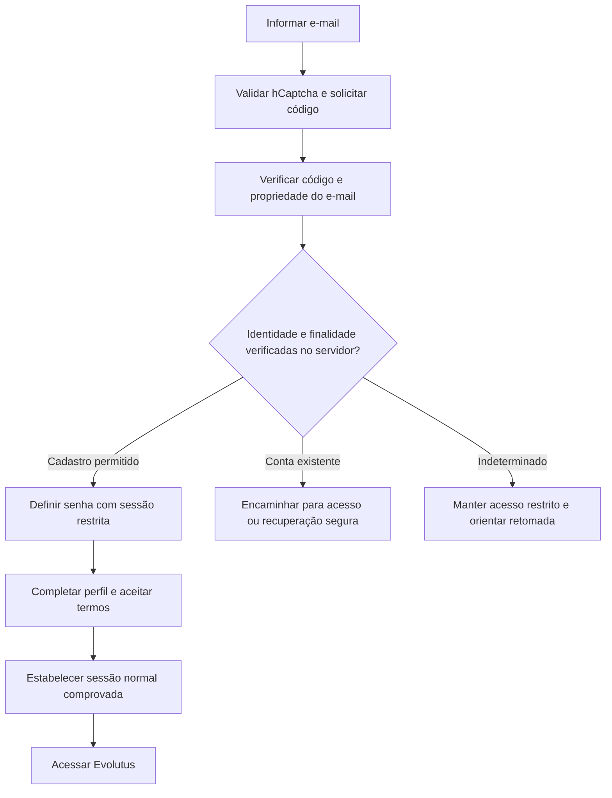

# Evolutus — Correção definitiva e reestruturação da autenticação

## 1. Missão

Atue como engenheiro de software sênior, especialista em React, Supabase Auth, PostgreSQL, segurança de aplicações, arquitetura e UX mobile-first. Assuma este trabalho no repositório existente do Evolutus.

Realize uma auditoria técnica do fluxo de autenticação, corrija a falha de cadastro em caráter prioritário e implemente uma evolução controlada da arquitetura. O resultado deve ser seguro, simples, previsível, sustentável, performático em celulares de entrada e compatível com os usuários e dados existentes.

Não entregue apenas um plano: investigue, reproduza, implemente e teste localmente por fases. Se uma decisão depender de configuração remota, capacidade do plano contratado, alteração irreversível ou impossibilidade técnica comprovada, documente o bloqueio e prossiga com as partes seguras. Não faça alterações remotas nem publique em produção sem autorização explícita.

## 2. Contexto e evidências iniciais

O usuário tenta criar uma conta nova. O código chega normalmente ao e-mail, mas a interface apresenta:

> Continue com seu e-mail — Não foi possível confirmar a criação da conta nem o envio de um código. Escolha como continuar.

Botões: Tenho um código, Entrar, Recuperar acesso e Corrigir e-mail. Existe ainda um contêiner vazio abaixo do formulário.

A auditoria do snapshot `treinos_academia-main (2)(4).zip` identificou os pontos abaixo. Confirme todos na HEAD atual: os números de linha são referências do snapshot, não contratos.

| Evidência | Local |
| --- | --- |
| `registerUser` retorna `ambiguous` quando `data.session` está ausente, mesmo sem erro do Auth | `src/services/authService.js:6–20` |
| `handleCreate` encaminha qualquer resultado sem sessão para `outcome`, zerando `signupStarted` | `src/pages/Register.jsx:395–462`, especialmente 435–442 |
| Confirmação OTP seguida de sincronização de senha, enquanto o Auth já pode emitir sessão | `Register.jsx:471–503`; `authService.js:206–250` |
| Redirecionamento de usuário autenticado depende de flags locais | `Register.jsx:526–532` |
| Segundo fluxo de confirmação define senha e encerra sessão separadamente | `src/pages/ConfirmEmail.jsx`; `authService.js:252–273` |
| Recuperação troca token por sessão, altera senha e tolera falha no encerramento | `src/hooks/useRecoveryTokenExchange.js`; `src/pages/ResetPassword.jsx:33–52` |
| Contexto global e proteção de rotas não foram demonstrados como suficientes para isolar a finalidade de sessões | `src/contexts/AuthContext.jsx`; `src/components/ProtectedRoute.jsx`; `src/pages/Login.jsx` |
| Seis chamadas sequenciais completam o perfil; username funciona como marcador implícito de conclusão | `src/services/profileCompletion.js:23–35`; `src/utils/profileCompletion.js:7–10` |
| Política local de senha: 8 caracteres, letras e números | `src/utils/validators.js`; `supabase/config.toml` |
| Rodapé do formulário renderizado sem conteúdo | `src/components/PublicLayout.jsx:140` |
| Testes existentes cobrem comportamentos anteriores, inclusive duplicidade | `src/pages/Register.test.js`; testes de Auth, CAPTCHA, sessão e perfil |

O último `has_app_access()` localizado no snapshot está em `supabase/migrations/20261114000001_financial_auth_integration.sql`. Ele já verifica `private.current_session_active()` e regras de conta/termos/restrições, mas não demonstra distinção entre sessão de recuperação, cadastro e login normal. A RPC `is_session_active()` está em `20261113000002_session_active_rpc.sql`. A existência de sessão ativa não equivale à autorização para todas as operações. Inspecione a definição efetiva após todas as migrations.

**Causa confirmada por leitura estática:** ausência de sessão durante confirmação obrigatória de e-mail é esperada no Supabase. Uma resposta sem sessão pode igualmente ser ofuscada para ocultar uma conta existente. A UX atual confunde essa situação com falha. Não conclua que todos os cadastros foram criados, nem que todos os e-mails foram entregues, apenas pelo sucesso da API. Os demais riscos requerem reprodução e testes de autorização; não os declare vulnerabilidades exploradas sem evidência.

## 3. Restrições inegociáveis

- Preservar Supabase Auth como provedor de identidade. Não implementar sistema próprio de hashing, armazenamento de senhas, emissão de JWT ou OTP.
- Manter login com e-mail e senha, confirmação por código, recuperação de acesso, hCaptcha, RLS, consentimentos legais, restrições, exclusão de conta, logout local/global e modo offline existente.
- Não desabilitar confirmação obrigatória de e-mail para resolver o bug. Não revelar a existência de contas por mensagens, endpoints, status distintos desnecessários ou checagens públicas de e-mail.
- Não remover proteções contra pre-account hijacking, revogação de sessão, bloqueios ou controles financeiros para facilitar a implementação.
- Não alterar regras de negócio de EvoCash, EvoCoins, InfinitePay, publicidade, comunidades, fichas ou demais módulos. Modificações nesses módulos somente quando indispensáveis à autorização, com testes de regressão.
- Preservar UUIDs, perfis, credenciais, relações, carteiras, histórico e aceites. Não apagar usuários pendentes, recriar identidades nem resetar produção.
- Nunca inserir `service_role`, secrets do CAPTCHA, chaves SMTP, JWT, senhas ou tokens em frontend, variáveis `VITE_*`, logs, commits, fixtures ou evidências. As chaves públicas do SDK são permitidas; não são controle de autorização.
- Evitar dependências novas sem justificativa mensurável. Seguir os componentes e padrões existentes. Código de produção em inglês onde já for convenção; textos da interface em português do Brasil.
- Não fazer refatoração ampla em um único commit nem aproveitar a tarefa para alterações sem relação. Não aplicar migrations antigas novamente ou editar migrations já publicadas.

## 4. P0 — Auditoria operacional e correção imediata do cadastro

### 4.1 Baseline

1. Inspecione `git status`, branch, HEAD, lockfile, instruções do repositório, PRs em andamento e versão efetivamente instalada de `@supabase/supabase-js`/Auth. O snapshot declara `^2.117.2` no `package.json`; confirme a resolução no lockfile.
2. Trace rotas, serviços, hooks, estado de autenticação, recuperação, criação do perfil, integração dos termos, exclusão/bloqueio, migrations, RLS, Edge Functions, Storage, Realtime, RPCs, cache PWA e mecanismos offline.
3. Reproduza o bug com teste de componente e, em Supabase local ou staging autorizado, com caixa de e-mail de teste. Registre a ordem dos eventos e o resultado sanitizado, sem dados pessoais ou segredos.
4. Verifique, se houver acesso autorizado, Auth Logs, logs do provedor SMTP e configuração do ambiente publicado. Caso não haja, forneça procedimentos de verificação para o mantenedor. Não confunda entrega do e-mail com conclusão do cadastro.
5. Identifique quais testes já passam antes da mudança e quais falhas são preexistentes.

### 4.2 Corrigir sem enfraquecer a segurança

- Diferencie aceitação de solicitação, sessão emitida, duplicidade explícita, rejeição definitiva e resultado desconhecido de transporte. Use resultados de domínio claros, por exemplo `verification_required`, `authenticated`, `request_uncertain`, `rejected`; os detalhes internos não devem vazar para mensagens públicas.
- `signUp` sem erro e sem sessão deve conduzir à confirmação por OTP. Não tratar como falha. Não inspecionar `identities` para determinar se o e-mail existe; não usar ID da resposta ofuscada para gravar perfil.
- Uniformizar a experiência pública de duplicidade e recuperação de acesso. A tela principal não pode confirmar que o endereço foi cadastrado ou que o código foi efetivamente enviado.
- Em timeout ou resposta perdida após possível aceitação, permitir informar código recebido e retomar de maneira controlada. Não repetir automaticamente `signUp`. Diferenciar esse estado de um erro comprovado de validação.
- Se uma sessão inesperada for retornada com confirmação de e-mail obrigatória, validar a configuração e a autorização; não abrir o app por simples existência de sessão.
- Preservar a sincronização segura de senha enquanto o fluxo legado existir. Tratar `same_password` como sucesso apenas no contexto específico demonstrado em teste de integração; não generalizar esse erro para recuperação ou outras operações.
- Capturar o propósito da operação antes da troca do OTP e impedir redirecionamento prematuro. Mitigação de UI nesta fase não substitui a autorização no servidor da P1.
- Atualizar os testes que cristalizam comportamento incorreto, preservando os testes anti-enumeração e anti-hijacking. Exigir reprodução antes/depois.

### 4.3 UX de confirmação

Título: **Confirme seu e-mail**.

Texto: “Confira sua caixa de entrada. Se recebeu um código, informe-o abaixo para continuar.”

Ação primária: **Confirmar e-mail**. Ações secundárias: Reenviar código, Corrigir e-mail, Entrar, Recuperar senha. Exibir endereço mascarado quando útil, orientação discreta sobre spam e prazo de reenvio. Não exibir um menu de quatro botões como substituto da confirmação normal nem anunciar falha sem evidência.

**Gate P0:** cadastro novo vai diretamente ao OTP; duplicidade não expõe existência de conta; código válido funciona; confirmação não abre app antes do passo de senha; nenhum fluxo existente relevante é quebrado. Produzir correção pequena e isolada, apta à homologação prioritária.

## 5. P1 — Arquitetura, máquina de estados e autorização por sessão

### 5.1 Separação de responsabilidades

Centralizar a orquestração de Auth em módulo/reducer/hooks seguindo a arquitetura atual. Manter componentes focados em apresentação, serviço responsável pelo SDK, regras puras de transição e um contrato explícito de autorização do backend. Evitar Redux, XState ou outro framework apenas para essa mudança.

Modelar estados como os abaixo, adaptando nomes ao projeto. A lista é conceitual: finalidade de autenticação, situação da conta, estado de onboarding e conectividade são dimensões diferentes; não criar uma única enumeração que perca combinações válidas.

| Estado | Acesso permitido |
| --- | --- |
| `INITIALIZING` | Carregamento, sem acesso protegido |
| `ANONYMOUS` | Rotas públicas e autenticação |
| `EMAIL_PENDING` | Solicitar/confirmar código |
| `PASSWORD_PENDING` | Definir senha da identidade comprovada |
| `PROFILE_PENDING` | Operações mínimas do próprio onboarding |
| `LEGAL_PENDING` | Consultar/aceitar documentos vigentes |
| `RECOVERY_PENDING` | Fluxo restrito de redefinição |
| `MFA_PENDING` | Cadastro/desafio MFA autorizado |
| `AUTHENTICATED` | App, conforme autorização, conta e papel |
| `OFFLINE_LOCAL` | Somente capacidades locais já previstas |
| `BLOCKED` | Informações/ações de suporte autorizadas |
| `ERROR` | Recuperação ou tentativa controlada, sem acesso indevido |

- A UI nunca será a autoridade de segurança. `user`, `hasSession`, `authLoading`, localStorage, route state, `useRef`, nome da rota, query string, `user_metadata`, presença de username ou evento `SIGNED_IN` não são prova suficiente de autorização.
- Tratar `INITIAL_SESSION`, `SIGNED_IN`, `SIGNED_OUT`, `TOKEN_REFRESHED`, `USER_UPDATED` e `PASSWORD_RECOVERY` quando efetivamente emitidos pelo fluxo/SDK. Verificar a semântica real de `verifyOtp` e recuperação (não pressupor que sempre emite `PASSWORD_RECOVERY`).
- Inscrever/desinscrever listener corretamente, não executar chamadas Supabase aguardadas dentro do callback de `onAuthStateChange`, evitar deadlocks e duplicações em StrictMode. Agendar trabalho fora do callback. Ignorar resultados obsoletos de outra sessão/usuário e controlar concorrência.
- Impedir troca silenciosa de identidade em aba já logada; definir comportamento de abrir confirmação ou recuperação com sessão de outra conta e de cancelar o fluxo.
- A navegação deve derivar do estado autorizado: sem loops, flicker de conteúdo protegido, redirects prematuros ou tela branca. Usuário autenticado e plenamente autorizado vai para `/app`.

### 5.2 Autorização no servidor — requisito de segurança central

Antes de escolher a arquitetura final, execute testes reais contra GoTrue local para mapear claims verificadas (`session_id`, `sub`, `aal`, `amr`), métodos de autenticação que cada fluxo emite e comportamento após refresh, mudança de senha, múltiplas abas e revogação. Não assumir existência de claim `purpose` ou que `amr` diferencia signup, recovery e login por OTP. Não usar `aal1` como prova de login por senha.

Projetar um mecanismo que permita ao backend distinguir uma sessão plenamente autorizada de uma sessão transitória. Preferir controles nativos comprovados, complementados apenas quando necessário por autorização server-side vinculada à sessão. Um desenho possível, sujeito à prova técnica, é gate positivo por sessão, com estado confiável no backend e comprovação de autenticação adequada antes da promoção. Não é suficiente registrar uma flag depois que o token já foi emitido ou aceitar uma RPC chamada pelo próprio cliente dizendo “login concluído”. Qualquer sessão não classificada tem acesso restrito por padrão no novo modelo; planejar compatibilidade com sessões antigas antes de ativá-lo.

Se um mecanismo confiável exigir hook do Auth, componente server-side ou migração de sessão, elaborar ADR com ameaças, provas, custos, permissões, comportamento de indisponibilidade e alternativas. Não simular isolamento na UI. Caso não seja possível provar a separação com a infraestrutura atual, não ativar o fluxo novo nem declarar o problema resolvido.

- Reaproveitar e fortalecer `private.current_session_active()`, `is_session_active()` e `has_app_access()`, evitando duplicar regras. Validar JWT, validade, vínculo ao usuário, sessão e finalidade/autorização confiável quando exigida.
- Inspecionar **todas** as superfícies protegidas: RLS (incluindo políticas permissivas combinadas por OR), views/grants, RPCs `SECURITY DEFINER`, Edge Functions, Storage, Realtime, rotas administrativas, carteiras, saldos, compras, estornos, dados pessoais e operações de exclusão.
- Separar autorização de onboarding/recuperação/termos da autorização normal. Manter allowlist mínima para operações intermediárias, sem dependências circulares com `has_app_access()` e sem bypass genérico para superadmin.
- Não confiar em UID ou papel vindo do body. Usar identidade verificada e `auth.uid()` no contexto apropriado. Não aceitar claims de roles em metadata editável pelo usuário.
- Funções SQL com menor privilégio; preferir `SECURITY INVOKER` quando possível. Se `SECURITY DEFINER` for indispensável, `search_path` fixo e referências qualificadas; grants explícitos; negar `PUBLIC`/`anon` onde não necessário; validar todos os argumentos e propriedade. Não conceder acesso ao schema `auth` ao cliente.
- Negar acesso direto com token de recuperação, token de onboarding ainda não autorizado, sessão revogada e sessão com MFA insuficiente nas operações abrangidas, inclusive fora do React.
- Verificar custo de RLS com `EXPLAIN (ANALYZE, BUFFERS)` em ambiente seguro e dados representativos; evitar consultas por linha quando expressão por statement for suficiente, sem negligenciar correção. Escrever policies explícitas e testáveis, evitar reescrever funções por regex genérica.

**Gate P1:** testes de integração demonstram isolamento backend mesmo em chamadas diretas, com JWT válido de sessão restrita. Testes apenas mockados não aprovam esta fase.

## 6. P2 — Cadastro definitivo: e-mail primeiro, senha depois

Arquitetura desejada, condicionada ao gate P1 e à análise anti-hijacking:



Verificar a viabilidade de `signInWithOtp` + `verifyOtp`, com templates/tipos corretos e `shouldCreateUser` explícito. **Atenção:** `signInWithOtp` é autenticação passwordless, não endpoint exclusivo de cadastro; pode autenticar contas existentes e emitir sessão válida. Não liberar login passwordless como efeito colateral nem transformar OTP em autorização automática para trocar senha de uma conta existente. A opção `shouldCreateUser: false` impede criação, mas não diferencia sozinha finalidade nem protege contas existentes.

- Definir como a identidade será criada sem senha controlada por um terceiro antes da verificação do e-mail; tratar pendências legadas e disputa entre tentativas concorrentes. Não usar senha fixa, previsível ou gerada no cliente como suposta proteção.
- Se o fluxo nativo não oferecer garantias suficientes, manter `signUp` convencional corrigido e protegido até existir uma alternativa comprovada. Não trocar API por conveniência e não criar Auth/OTP artesanal.
- Após confirmação verificada, permitir apenas completar as etapas autorizadas. Preferir login explícito com a senha definitiva caso necessário à comprovação do novo acesso normal.
- Remover `syncSignupPassword` apenas quando o cenário de pre-account hijacking estiver comprovadamente eliminado no fluxo novo e no tratamento de pendências legadas. Não assumir que confirmação do e-mail troca a senha inicial de cadastro pendente.
- Impedir acesso a dados de conta existente por fluxo de cadastro, alterações silenciosas de senha, criação de perfil paralelo ou associação de identidade indevida.
- Tratar envio duplicado, edição de e-mail, abandono, recarga, fechamento de aba, troca de dispositivo, sessão expirada e correção de senha. Retomar etapas de maneira segura sem persistir segredos em storage. Quando não houver retomada segura, solicitar nova prova de identidade.
- Preservar requisitos legais, idade mínima (snapshot: 16 anos ou maior se exigido pelo manifesto), política de privacidade, versão/digest dos termos. Se mover a coleta da idade/consentimento para depois do OTP, revisar a base legal para criação da identidade mínima e regras para menores antes de ativar a mudança. A ordem pode ser ajustada por necessidade legal ou técnica.

**Gate P2:** conta existente, pendente e nova são tratadas corretamente; nenhum método de OTP contorna a autenticação prevista; teste adversarial demonstra que o pré-cadastro por terceiro não concede acesso nem mantém senha/sessão do atacante.

## 7. P3 — Conclusão do perfil e termos

Consolidar as operações efetivamente pertencentes ao PostgreSQL em uma RPC transacional e idempotente, proposta: `complete_user_onboarding(...)`, reaproveitando as regras existentes em `usersService`, `usageProfileService` e `legalService`.

- Identificar usuário via `auth.uid()`; verificar sessão e escopo de onboarding autorizado. Validar username normalizado e unicidade por índice/constraint, nascimento/idade, sexo conforme regras atuais, município pelo código IBGE, perfil de uso e aceites. Não confiar em flags de validação do navegador.
- Gravar todos os dados obrigatórios atomicamente; falha em qualquer etapa não pode marcar onboarding completo. Não sobrescrever um perfil concluído por replay de requisição antiga ou permitir alterações que deveriam usar fluxos próprios. Resolver concorrência entre abas.
- Usar marcador explícito controlado pelo servidor (por exemplo `onboarding_completed_at` ou mecanismo existente equivalente), com backfill baseado em regras comprovadas. Não usar somente username como fonte de verdade; distinguir perfil ausente, erro de leitura e incompleto.
- Preservar aceites históricos, timestamps, versão e digest obtidos/validados pelo servidor. Se os documentos mudarem no meio do cadastro, exigir nova apresentação e concordância; não aceitar automaticamente.
- `setDisplayName` atualmente faz `auth.updateUser` e não pertence à mesma transação de uma RPC via API. Investigar consumidores de `user_metadata.display_name`; eliminar a cópia redundante se comprovadamente dispensável ou sincronizar separadamente de modo seguro e recuperável. Não gravar tabelas internas de Auth à força.
- Auth e PostgreSQL podem não compartir uma transação de negócio: modelar transições idempotentes e compensação/retomada, sem prometer atomicidade global.
- Evitar consultas repetidas de disponibilidade de username; utilizar debounce, cache curto e cancelamento/ignorar resposta obsoleta. A restrição no banco é definitiva. Tratar conflito de unicidade de forma amigável.
- Retornar apenas dados necessários e atualizar cache/contexto com segurança, invalidando-o quando necessário. Não duplicar cargas de perfil e acesso entre páginas.

Meta: reduzir as seis chamadas atuais para uma RPC de dados, mais apenas as operações de Auth/legal realmente indispensáveis. A redução de 83,3% é potencial para aquele conjunto, não ganho global medido. Medir antes/depois e informar os números reais.

## 8. P4 — Login, recuperação, sessões e offline

### Login

- Manter `signInWithPassword`, hCaptcha nos endpoints suportados e autenticação por senha com tratamento neutro de credenciais incorretas, usuário inexistente ou conta pendente quando a existência ainda não foi comprovada.
- Sem enumeração por mensagens, APIs auxiliares ou diferenças triviais de tempo. Aplicar rate limits nativos e avaliar respostas estatisticamente; não prometer tempo constante em rede.
- Tratar sessão inicial, expiração, refresh, múltiplas abas, conta bloqueada, mudança de conta e falha de perfil. Não conceder acesso por erro de requisição. Não confundir falha de rede com sessão revogada.

### Recuperação de senha

- Requisição de recuperação sempre com mensagem neutra: “Se houver uma conta elegível para este e-mail, você receberá as instruções.” Não consultar e-mail publicamente.
- Preservar o template de recovery e troca segura de `token_hash` quando adequados. Validar tipo, expiração, uso único, domínio, HTTPS, Site URL e redirects autorizados. Nunca usar URLs de destino vindas de parâmetros sem allowlist.
- Limpar o token da URL imediatamente, antes de telemetria ou requisições dispensáveis. Auditar logs de Vercel, cabeçalhos/referrer, analytics, scripts terceirizados e service worker para evitar exposição por URL. Aplicar política de referrer apropriada nas páginas sensíveis.
- Avaliar scanners de e-mail: confirmação por código evita consumo acidental por cliques em links; para recovery, validar o comportamento atual e avaliar etapa explícita de confirmação ou OTP de recuperação se compatível. Não trocar templates sem garantir suporte simultâneo a mensagens já emitidas.
- Sessão emitida por recovery fica restrita; não pode acessar `/app`, dados pessoais, carteira, administração ou sincronização apenas por possuir JWT.
- Após troca de senha, revogar outras sessões e encerrar sessão transitória, exigindo login normal. Diferenciar senha alterada, revogação pendente e logout não confirmado. A senha alterada não é desfeita por falha de rede; não reportar sucesso completo falso. Usar revalidação/retry seguro sem repetir atualização desnecessária e sem liberar sessão insegura.
- Avaliar notificação transacional de alteração de senha e explicação de recuperação sem expor a senha; nunca enviar a senha por e-mail.
- Alteração de senha/e-mail em sessão normal: exigir reautenticação recente e MFA quando aplicável. Confirmar e-mail antigo e novo conforme configuração/risco. Não permitir bypass por sessão pendente.

### Logout e revogação

- Preservar contratos atuais de `logoutUser`, `logoutAllDevices`, `runExclusive` e `disableOfflineAccess`. Saída local não deve revogar outros dispositivos; saída global deve confirmar revogação e distinguir falha de limpeza local.
- Não depender somente de expiração do JWT para operações críticas: access tokens podem permanecer criptograficamente válidos após signOut. Reusar verificação server-side de sessão revogada e validar cobertura financeira/admin.
- Garantir limpeza do estado privado/cache, canais Realtime e assinaturas apropriadas, sem destruir outbox legítima de treinos não sincronizados. Separar outbox por UID e impedir replay em outra conta.
- Aplicar isolamento por sessão também em recuperação, troca de senha e logout abortado. Não registrar como bem-sucedida uma revogação não confirmada.

### Offline

- Preservar a janela existente de até 24h para acesso local elegível, sem ampliar permissões.
- Nunca ativar modo offline para sessão de recuperação, onboarding incompleto, conta bloqueada já conhecida ou MFA administrativa pendente. Operações financeiras, administração e segurança exigem online/autorização atual.
- Em cold start offline, permitir exclusivamente capacidades locais já autorizadas, isoladas por usuário. Ao reconectar, revalidar sessão, conta, termos e permissões antes de sincronizar; bloquear operações se revogada.
- Documentar que servidor não consegue revogar imediatamente dados já acessíveis em dispositivo genuinamente offline; mitigar com expiração, isolamento e limpeza ao reconectar.

## 9. P5 — Hardening e configurações do Supabase Auth

Comparar configuração local e remota efetiva. O arquivo `supabase/config.toml` não garante a configuração do projeto hospedado. Não aplicar mudanças via Management API sem aprovação. Gerar checklist com valor atual, recomendado, disponibilidade no plano, impacto, como validar e como reverter.

| Controle | Snapshot local | Proposta inicial para homologação |
| --- | --- | --- |
| Confirmação de e-mail | Habilitada | Manter obrigatória |
| Senha mínima | 8 | 15 para novos cadastros e alterações, considerando login de fator único |
| Composição | `letters_digits` | Remover obrigatoriedade de classes; permitir frases longas |
| OTP | 6 dígitos | Manter, com expiração e tentativas controladas |
| Expiração de OTP | 3.600s | Avaliar 600s; confirmar impacto em recovery e outros links de e-mail |
| Reenvio | `1s` | Avaliar 60s efetivos no servidor e UI sincronizada |
| Alteração segura de senha | `false` | Avaliar habilitação e reautenticação, testar fluxos intermediários |
| CAPTCHA | Exemplo comentado localmente | Manter hCaptcha real verificado no servidor; configuração de teste isolada |
| Refresh rotation | Habilitada | Manter |
| JWT | 3.600s | Preservar inicialmente; avaliar ajustes com revogação, offline e carga |
| MFA TOTP | Revisar configuração efetiva | Ativar progressivamente para superadmins |
| Senhas comprometidas | Não confirmado | Habilitar proteção nativa se disponível; avaliar custo/plano |
| SMTP e limites | Não confirmados | Auditar entrega, reputação, capacidade e quota real |

### Senhas — NIST/OWASP

Aplicar recomendações como referência técnica, não declarar conformidade integral com NIST. Permitir gerenciadores, colagem, preenchimento automático, espaços e caracteres suportados. Não truncar, forçar rotação periódica arbitrária, normalizar/trimar senha silenciosamente nem exigir mistura de classes. Suportar pelo menos 64 caracteres quando compatível com o provedor; verificar limites reais de bytes/caracteres e do bcrypt/SDK, inclusive Unicode. Se houver limite incompatível, documentar e validar de maneira explícita; nunca inventar hashing no cliente. Integrar bloqueio de senhas comuns/vazadas pelo mecanismo nativo ou alternativa aprovada, sem enviar senha em claro a terceiros. Política nova deve valer para criação/alteração; não impedir login de usuário existente apenas por ter senha antiga menor. Evitar reset global não autorizado.

### OTP, antiabuso e CAPTCHA

- OTP em e-mail comprova acesso à caixa postal, não equivale a MFA forte/AAL2. Limitar brute force, reenvios e abuso de consumo de e-mails no servidor; cooldown apenas visual não protege endpoints diretos.
- Verificar limites nativos por usuário/IP/projeto, respostas 429, capacidade SMTP, tentativas de verificação, concorrência e impacto em redes compartilhadas. Ajustar com dados, sem bloquear usuários legítimos por IP isolado.
- Não criar tabela pública de e-mails nem endpoint de consulta de existência. Não implantar proxy de rate limit que possa ser contornado pelo endpoint público do Auth sem documentar/mitigar a limitação.
- Reutilizar `AuthCaptcha`, `authCaptcha.js` e paths de signup/login/recovery/resend; token novo por requisição conforme SDK, reset correto, tratamento de expiração, ausência de chave, erro/rede e indisponibilidade. CAPTCHA validado no servidor; sem fallback silencioso em produção. Não exigir CAPTCHA desnecessário a cada render.
- Validar domínios localhost/staging/produção e testes de Brave, Chrome e mobile. Não fixar segredo de teste em produção.

### E-mails e configuração

- Conferir templates em `supabase/templates/`, tipos de OTP, validade, código de seis caracteres numéricos, recuperação, alterações de senha/e-mail, links/domínios e idioma pt-BR.
- Manter marca Evolutus, instruções simples e conteúdo responsivo. Configurar SMTP, SPF/DKIM/DMARC, remetente, bounces e quotas com o responsável. A configuração depende do provedor e do plano; não contratar serviço sem autorização.
- Validar Site URL, redirects estritamente permitidos, ambientes separados, CSP, HTTPS, proteção contra XSS, cache de dados sensíveis, prevenção de open redirects e referrer.

### MFA / superadmins

- Implementar MFA TOTP nativa do Supabase, com matrícula, confirmação inicial, desafio, UX de recuperação/contingência operacional e reautenticação de ações críticas. Avaliar MFA para demais usuários como opção posterior.
- Exigir `aal2` comprovado no backend em operações administrativas definidas; não apenas tela de código. Usuário sem fator deve ter acesso mínimo para matrícula segura, sem privilégio administrativo antecipado.
- Fazer rollout em fases: inventário e matrícula dos admins legítimos, validação de método de contingência, teste com segundo administrador autorizado e somente então enforcement. Não permitir bypass por parâmetro, e-mail, papel local ou recovery improvisado. Supabase MFA não garante códigos de recuperação nativos: verificar suporte real e documentar alternativa segura (ex.: múltiplos fatores e procedimento controlado de suporte).
- Não afetar usuários comuns sem MFA nem criar dependência de conexão para recursos offline não administrativos existentes.

## 10. P6 — UX, acessibilidade e performance

Fluxo desejado de 4 etapas, adaptável às exigências de segurança/idade: (1) e-mail e CAPTCHA; (2) código; (3) senha; (4) perfil e termos. Login e recuperação devem ter a menor quantidade possível de passos. Reusar `PublicLayout`, `AuthLayout`, `NewPasswordFields`, componentes visuais e design tokens atuais. Manter tema claro/escuro e identidade Evolutus.

- Mobile-first em 320/360/390px e desktop; sem scroll horizontal, elementos cortados, logo/hero distorcido ou rodapés vazios. Renderizar `auth-switch` somente com conteúdo real. Hero decorativo não pode prejudicar carregamento do formulário em celular.
- Um CTA primário por etapa; links secundários discretos. Indicador de progresso consistente, títulos e mensagens diretas em pt-BR; sem códigos SQL/HTTP ou erros internos em UI.
- OTP: preferir input único semântico de 6 dígitos, podendo ter visual segmentado; preservar zeros à esquerda, `inputMode="numeric"`, `autoComplete="one-time-code"`, colagem e leitor de tela. Não usar `type=number`. Confirmar por ação intencional, impedir duplicidades; mostrar loading curto e erro no campo.
- Senhas: `autocomplete` apropriado (`current-password`, `new-password`), mostrar/ocultar acessível, confirmação com erros claros, gerenciadores funcionais. E-mail com autocomplete adequado. Não remover preenchimento automático por segurança fictícia.
- Acessibilidade WCAG 2.2 AA como meta: semântica, labels, foco visível, ordem de teclado, aria-live, mensagens associadas, contraste, alvos de toque confortáveis e layout adaptável. Não transmitir estado apenas por cor.
- Sem modais/popups desnecessários; formulários pequenos. Evitar perda de dados não sensíveis entre passos; não persistir OTP, senha ou token. Ao abandonar, descartar segredos e sessão intermediária conforme contrato.
- Deduplicar submissões, reenviar sem recarregar, limpar timers/requests, evitar efeitos em cascata, chamadas redundantes e requests por render. Lazy load de rotas/recursos pesados quando vantajoso. Não adicionar biblioteca pesada para estado, OTP ou animações simples.
- Meta: nenhuma regressão de bundle budget, cold start, modo offline ou consultas no fluxo de login. Medir contagem por etapa, payload, latência p50/p95 quando houver amostra válida, CPU/rede simuladas no navegador e LCP/CLS relevantes. Diferenciar medidas locais de produção; não inventar percentuais.

## 11. P7 — Observabilidade, testes e regressão

### Observabilidade

Eventos estruturados e sanitizados usando infraestrutura existente: `signup_requested`, `verification_required`, `otp_verified`, `onboarding_completed`, `recovery_requested`, `password_changed`, `session_revocation_pending`, `auth_access_denied`, `captcha_failed`, `auth_rate_limited`. Separar solicitação aceita de entrega comprovada. Não incluir e-mail, senha, token, código, URL de recovery completa, payload sensível ou IDs correlacionáveis desnecessários em analytics. Usar códigos de erro estáveis, correlation ID opaco quando viável e retenção mínima. Auditar logs já existentes. Evitar novos serviços pagos.

### Matriz mínima de testes

| Grupo | Casos obrigatórios |
| --- | --- |
| Cadastro | Novo e-mail; e-mail existente confirmado; pendente; resposta ofuscada; duplicidade explícita; API sem sessão; sessão inesperada; erro de transporte depois de aceitar; duplo clique; corrida entre abas |
| OTP | Correto; incorreto; expirado; usado; zeros iniciais; colagem; reenvio; token anterior após reenvio conforme comportamento comprovado; tentativas excessivas; e-mail corrigido; aba/dispositivo diferente |
| Hijacking | Pré-cadastro por terceiro com senha conhecida por ele; vítima confirma; senha e sessões anteriores não concedem acesso; recuperação por conta existente não é contornada pelo cadastro; testes de API direta |
| Sessões restritas | Token válido de signup/recovery não lê/grava recursos protegidos via REST/RPC/Storage/Realtime/Edge; refresh não eleva acesso; alteração de metadata/estado local não eleva privilégios |
| Login | Credencial válida/inválida; e-mail inexistente; pendente; logout; expiração; refresh; troca de identidade; sessão antiga; múltiplas abas; bloqueio/exclusão; ausência de rede |
| Recuperação | Token válido/expirado/reutilizado; URL sem token; scanner quando aplicável; troca de senha; falha de revogação; fail-closed; login posterior; outra conta logada na aba |
| Perfil | Todos os campos; idade inválida; IBGE inválido; conflito de username; falha transacional intermediária; replay; termos atualizados no meio; usuário legado; UID de terceiro fornecido no body |
| MFA | Matrícula/desafio; AAL insuficiente; AAL2 válido; recovery de superadmin; tentativas; fator perdido; rollout sem bloquear todos admins; acesso administrativo direto |
| Antiabuso | CAPTCHA inválido/expirado/indisponível; 429; chamadas diretas sem CAPTCHA nos endpoints protegidos; rate limit real; respostas públicas sem enumeração; XSS/open redirect |
| Offline | Janela de 24h; cold start autorizado; sessão transitória rejeitada; logout offline; revogação ao reconectar; outbox preservada e isolada por conta |
| Regressão | Carteira, EvoCash/EvoCoins, pagamentos InfinitePay, publicidade, comunidades, fichas, push, termos, bloqueios, exclusão e perfis existentes |
| UX | Mobile e desktop; teclado/leitor de tela; temas; baixa velocidade; falhas de rede; telas sem conteúdo vazio ou loops; formulário com gerenciador de senha |

Reutilizar suites do projeto: `Register.test.js`, `authRecoveryFlow.test.js`, `authCaptchaFlow.test.js`, `AuthCaptcha.test.js`, `authColdStart.test.js`, `ProtectedRoute.test.js`, `profileCompletion.test.js`, `authErrors.test.js`, `authSession.test.js`, `useRecoveryTokenExchange.test.js`, testes de logout e SQL, incluindo `aud_has_app_access_gates_test.sql` e `finance_auth_integration_test.sql`. Atualizar caminhos após verificar a HEAD. Cobrir lógica pura, componentes, integração com GoTrue real, banco/RLS e E2E em browser. Mocks não provam RLS, comportamento de emissão de token nem revogação real.

Rodar verificações de acordo com scripts existentes e alterações realizadas, preferencialmente local:

```bash
npm ci
# Testes direcionados durante cada fase; confirme os caminhos na HEAD
node --test --test-concurrency=1 src/pages/Register.test.js src/services/authRecoveryFlow.test.js
npm run validate:local
npm run test:functions
# Banco de desenvolvimento local, somente se disponível e seguro
npx supabase test db
```

Verificar precondições, migrations e versão da CLI antes dos comandos. Não executar reset no banco remoto; não executar comandos destrutivos em ambiente não verificado. Validar formatação dos arquivos alterados, lint, build, budget, migração, browser smoke e suites obrigatórias do repo. Reportar comandos executados, resultados reais, duração e bloqueios; não declarar sucesso de testes não rodados.

## 12. Git, CI, migrations e lançamento controlado

O GitHub Actions gera custo. Executar o máximo possível localmente e de forma direcionada. Não disparar CI a cada pequeno ajuste, não desabilitar checks de segurança nem contornar branch protection.

1. Preservar trabalho em andamento, verificar PRs concorrentes, atualizar a `main` somente em árvore limpa e criar branch específica a partir da base atual (ex.: `fix/auth-signup-hardening`). Se houver trabalho de autenticação já em branch, integrar de modo seguro; não sobrescrever.
2. Commits pequenos por fase. Preferir separar hotfix P0 do reforço de backend e da mudança email-first se o acoplamento permitir; documentar dependências e contratos. Um PR por unidade de entrega verificável, não um PR por ajuste trivial. Evitar pushes repetidos. Se não houver publicação autorizada, manter local ou apresentar diff conforme instrução do mantenedor.
3. Migrations novas, aditivas e reversíveis quando possível, com nomes timestamp conforme repo. Não alterar histórico aplicado. Planejar lock timeout, índices, backfill em volume realista, permissões, consistência de dados, e testes de versão anterior/seguinte. Se uma migration for irreversível, explicitar plano de mitigação, backup/recuperação conforme impacto antes de autorizar produção.
4. Compatibilidade de deploy: expandir backend primeiro de forma compatível, preparar frontend e gates, ativar enforcement/novo fluxo somente após comprovação em staging e aprovação. Se usar flag, ela não pode permitir bypass de autorização, depender de valor controlável pelo cliente ou afrouxar a segurança na falha. Planejar sessões legadas e matrículas MFA; não revogar todas as sessões sem aprovação.
5. Verificar aplicação de migrations, configurações Auth hospedadas, templates e Edge Functions efetivamente necessários. Listar comandos de diagnóstico/aplicação específicos do projeto apenas após confirmar identificadores e ambiente. Não publicar segredo ou copiar dados reais para testes.
6. Solicitar publicação após gates, revisão, CI obrigatório verde e checklist de smoke. Não mesclar PR, alterar secrets, usar `db push` remoto, fazer deploy Vercel ou configurar Auth remoto sem autorização. Descrever rollback de frontend e medidas de contenção que não reabram falhas de segurança. Se o novo frontend depender de proteção backend, não fazer rollback dessa proteção isoladamente.
7. Após PR final aprovado, mesclado e versão confirmada em produção, atualizar `main` local e limpar somente branches integradas e sem trabalho pendente, deixando `main` como única branch de trabalho local quando seguro. Não deletar branches remotas ou não mescladas indiscriminadamente. Novas tarefas partem da `main` atualizada.

## 13. Critérios finais de aceite (Definition of Done)

- [ ] Cadastro novo encaminha diretamente à confirmação; não exibe falsa falha quando a API aceita a solicitação sem sessão.
- [ ] Interface neutra e sem enumeração de e-mails; testes mostram que duplicidade não cria perfil/identidade paralela nem revela a existência de conta indevidamente.
- [ ] Cenário de pre-account hijacking coberto por GoTrue real, sem regressão da proteção anterior.
- [ ] Sessões de recuperação/cadastro não autorizado têm privilégios mínimos verificados server-side, inclusive com chamadas diretas a recursos protegidos.
- [ ] Nenhum acesso prematuro ao app por evento de Auth, reload, múltiplas abas ou race condition.
- [ ] Login normal, logout, recuperação, revogação, bloqueio, exclusão e offline mantêm contratos seguros e UX coerente.
- [ ] Onboarding usa operação transacional para dados de banco, idempotente, com validação server-side e compatibilidade de usuários existentes.
- [ ] Política de senha, OTP, CAPTCHA, limites e e-mails validada em ambiente real de teste; alterações remotas ainda necessárias claramente listadas.
- [ ] MFA administrativa implementada/homologada ou bloqueio específico documentado; enforcement só após preparação segura dos administradores.
- [ ] UX responsiva, acessível, simplificada, localizada para pt-BR; sem rodapé vazio ou informações enganosas.
- [ ] Sem segredos, permissões excessivas, gaps em RLS, regressões financeiras ou expansão indevida do escopo.
- [ ] Testes automatizados e manuais necessários executados, métricas reais registradas, plano de migração e rollback revisados.
- [ ] Nenhuma mudança remota ou publicação realizada sem autorização explícita.

Não marcar um item como concluído quando depender de teste não executado, produção não inspecionada ou capacidade do plano não confirmada. P0 pode ser homologado separadamente; a reestruturação completa só será considerada concluída após todos os gates aplicáveis.

## 14. Entrega esperada

Ao concluir cada fase, apresente um relatório objetivo contendo:

1. Causa raiz e evidências (arquivo, função, teste e comportamento observado).
2. Riscos adicionais, severidade, impacto e status de reprodução.
3. Decisões de arquitetura e alternativas descartadas, especialmente sobre e-mail primeiro, sessão autorizada e MFA.
4. Arquivos alterados/criados/removidos e migrations, com justificativa.
5. Testes executados e respectivos resultados; falhas, testes pendentes e bloqueios reais.
6. Economia medida de chamadas, desempenho e custos adicionais previstos (se houver), sem estimativas apresentadas como medições.
7. Configurações que o mantenedor precisa ajustar manualmente no Supabase/Vercel/SMTP, com instruções seguras e valores verificados.
8. Checklist de homologação, rollout, rollback e status de produção/PR/branch.

Entregue código limpo e pronto para revisão; não apenas sugestões. Inicie pela P0 e avance para as fases posteriores após os respectivos gates técnicos. Caso o fluxo email-first não possa ser implementado de forma segura, entregue a correção do fluxo convencional e informe exatamente o que falta para habilitar a alternativa. Não confunda correção de UX com garantia de segurança.

## 15. Referências oficiais de engenharia e segurança

Consultar a versão atual e o comportamento da versão instalada no projeto. Links de referência verificados em 18/11/2026:

- [Supabase — signUp](https://supabase.com/docs/reference/javascript/auth-signup)
- [Supabase — signInWithOtp](https://supabase.com/docs/reference/javascript/auth-signinwithotp)
- [Supabase — Passwordless email sign-in](https://supabase.com/docs/guides/auth/auth-email-passwordless)
- [Supabase — Password security](https://supabase.com/docs/guides/auth/password-security)
- [Supabase — Password-based Auth](https://supabase.com/docs/guides/auth/passwords)
- [Supabase — User sessions](https://supabase.com/docs/guides/auth/sessions)
- [Supabase — JWT claims](https://supabase.com/docs/guides/auth/jwt-fields)
- [Supabase — Custom access token hook](https://supabase.com/docs/guides/auth/auth-hooks/custom-access-token-hook)
- [Supabase — onAuthStateChange](https://supabase.com/docs/reference/javascript/auth-onauthstatechange) e [deadlock no callback](https://supabase.com/kb/troubleshooting/why-is-my-supabase-api-call-not-returning-PGzXw0)
- [Supabase — Signing out](https://supabase.com/docs/guides/auth/signout)
- [Supabase — Rate limits](https://supabase.com/docs/guides/auth/rate-limits)
- [Supabase — CAPTCHA](https://supabase.com/docs/guides/auth/auth-captcha)
- [Supabase — MFA](https://supabase.com/docs/guides/auth/auth-mfa) e [TOTP](https://supabase.com/docs/guides/auth/auth-mfa/totp)
- [Supabase — Auth error codes](https://supabase.com/docs/guides/auth/debugging/error-codes)
- [Supabase — Auth audit logs](https://supabase.com/docs/guides/auth/audit-logs)
- [Supabase — Production security checklist](https://supabase.com/docs/guides/security/production-checklist)
- [OWASP — Authentication Cheat Sheet](https://cheatsheetseries.owasp.org/cheatsheets/Authentication_Cheat_Sheet.html)
- [OWASP — Forgot Password Cheat Sheet](https://cheatsheetseries.owasp.org/cheatsheets/Forgot_Password_Cheat_Sheet.html)
- [NIST SP 800-63B-4 — Authentication and Authenticator Management](https://pages.nist.gov/800-63-4/sp800-63b.html)

**Diretriz final:** segurança no servidor, experiência simples no cliente, mínimo de chamadas ao banco, compatibilidade com a base existente e nenhuma publicação sem validação. Priorize corrigir o cadastro que está falhando hoje, sem abrir uma vulnerabilidade nova amanhã.
